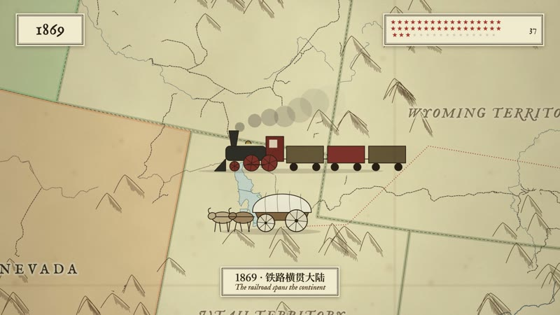
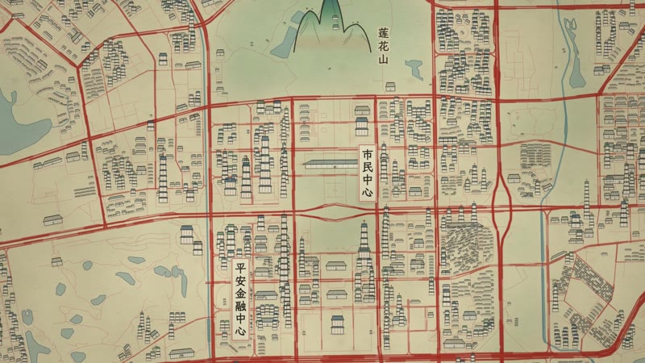
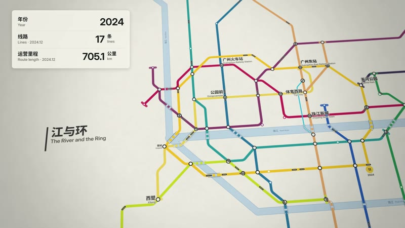
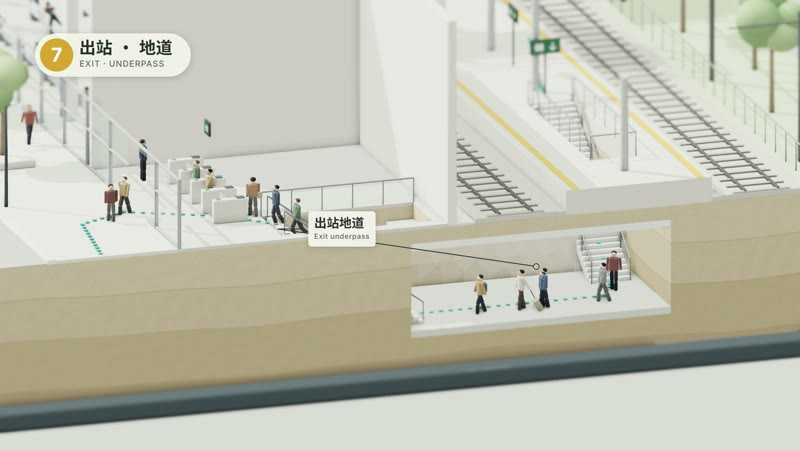
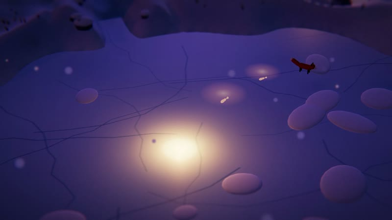
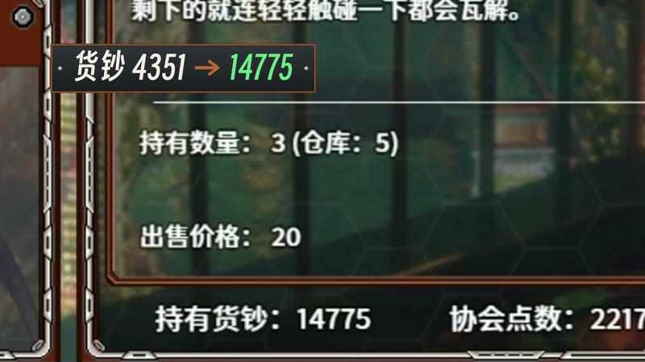

<div align="center">

# NEO-Cine

**Film styles made in code, by NEO, one at a time.**<br>
Pick a style, bring your story, and let your coding agent direct.<br>
<sub>NEO 的代码影片风格库，风格一个一个做，每种都配一支完全用代码做出来的短片 · 🇨🇳 中文用户请看 <a href="README.zh-CN.md">简体中文说明</a></sub>

<a href="https://neohoy.github.io/neo-cine/"></a> <a href="README.zh-CN.md"></a> <a href="https://github.com/neohoy/neo-cine/stargazers"></a> <a href="#thanks-and-licence"></a>

⚠️ **Built for Claude Code.** The styles are made and tuned with Claude;<br>
other agents may not reproduce them well.

🆕 **2026-11-20 · [Style 09: Game Launch](https://neohoy.github.io/neo-cine/)**: a trailer for your own game, made from its gameplay recording, key art and store page. Real gameplay fills the frame, captions sit on plates cut from the game's own UI, the camera pushes in on one real payoff (here a trade counter, 4351 → 14775) on the beat of the game's own score, and the logo lands with where to play it. Demo: a Demo trailer for the indie RPG 《归路：新旅途》, with the developer's permission. Product Launch now has two styles (07, 09). [See them ↓](#the-styles)

<sub>Official repo: [github.com/neohoy/neo-cine](https://github.com/neohoy/neo-cine) · by NEO造物集 ([@neohoy](https://github.com/neohoy))</sub>

</div>

## The styles

One frame and one line for each style. Click a frame for its `STYLE.md`, and watch the films in the [gallery](https://neohoy.github.io/neo-cine/). More are on the way, one at a time.

<!-- styles:start -->

<table>
<tr>
<td width="33%" valign="top"><a href="styles/folding-city/STYLE.md"></a><br><b>01 · Folding City</b><br><sub>City Skyline · <i>Shenzhen, Folded</i> · 0:40</sub><br>Three districts of Shenzhen as flat posters that open into streets, fold like doors and screens, and stand up as walls until the city closes into a U.<br><sub><a href="styles/folding-city/STYLE.md">Style prompt</a> · <a href="styles/folding-city/DEMO.md">Demo notes</a> · <a href="https://github.com/neohoy/neo-cine/releases/download/films/folding-city.mp4">Download 1080p</a></sub></td>
<td width="33%" valign="top"><a href="styles/atlas-scroll/STYLE.md"></a><br><b>02 · Atlas Scroll</b><br><sub>City Skyline · <i>From Thirteen to Fifty</i> · 0:56</sub><br>A hand-coloured atlas plate unrolls westward: the states take their colours year by year, a covered wagon leads the way to the Pacific, and in 1869 the railway overtakes it.<br><sub><a href="styles/atlas-scroll/STYLE.md">Style prompt</a> · <a href="styles/atlas-scroll/DEMO.md">Demo notes</a> · <a href="https://github.com/neohoy/neo-cine/releases/download/films/atlas-scroll.mp4">Download 1080p</a></sub></td>
<td width="33%" valign="top"><a href="styles/scroll-map/STYLE.md"></a><br><b>03 · Scroll Map</b><br><sub>City Skyline · <i>Shenzhen, Unrolled</i> · 0:48</sub><br>A handscroll unrolls along the real coast of Shenzhen: ink traces the shore, blue-green mountains stand up, cinnabar roads spread from Luohu and the towers of Futian rise as tiered pavilions.<br><sub><a href="styles/scroll-map/STYLE.md">Style prompt</a> · <a href="styles/scroll-map/DEMO.md">Demo notes</a> · <a href="https://github.com/neohoy/neo-cine/releases/download/films/scroll-map.mp4">Download 1080p</a></sub></td>
</tr>
<tr>
<td width="33%" valign="top"><a href="styles/transit-map/STYLE.md"></a><br><b>04 · Transit Map</b><br><sub>City Skyline · <i>The River and the Ring</i> · 0:54</sub><br>A printed octilinear map of Guangzhou&#x27;s real metro is dragged out line by line from five stations under the Pearl River in 1997, trains running on every finished line, until Line 11 closes the ring and the counter lands on 19 lines and 779.9 km.<br><sub><a href="styles/transit-map/STYLE.md">Style prompt</a> · <a href="styles/transit-map/DEMO.md">Demo notes</a> · <a href="https://github.com/neohoy/neo-cine/releases/download/films/transit-map.mp4">Download 1080p</a></sub></td>
<td width="33%" valign="top"><a href="styles/miniature/STYLE.md"></a><br><b>05 · Miniature</b><br><sub>City Skyline · <i>How a High-Speed Station Works</i> · 1:09</sub><br>A fictional high-speed rail station cut open on a thin plinth: the roof lifts away, and one passenger with a suitcase is followed in seven numbered steps, from the taxi through ID and security checks, the waiting hall, the ticket gates and the overpass to the train, while the other side walks out through the underpass; then the roof closes and the lights come on.<br><sub><a href="styles/miniature/STYLE.md">Style prompt</a> · <a href="styles/miniature/DEMO.md">Demo notes</a> · <a href="https://github.com/neohoy/neo-cine/releases/download/films/miniature.mp4">Download 1080p</a></sub></td>
<td width="33%" valign="top"><a href="styles/scrapbook-song/STYLE.md"></a><br><b>06 · Scrapbook Song</b><br><sub>Frame by Frame · <i>Wind Through Hsinchu</i> · 0:48</sub><br>The bridge and last chorus of hoy neo&#x27;s song 风吹新竹, drawn frame by frame: two friends in two cities, a suitcase packed with home, a gust of wind on the chorus, a night street of lighting windows, and the word 家 (home) slammed down in the last lit one.<br><sub><a href="styles/scrapbook-song/STYLE.md">Style prompt</a> · <a href="styles/scrapbook-song/DEMO.md">Demo notes</a> · <a href="https://github.com/neohoy/neo-cine/releases/download/films/scrapbook-song.mp4">Download 1080p</a></sub></td>
</tr>
<tr>
<td width="33%" valign="top"><a href="styles/tech-launch/STYLE.md"></a><br><b>07 · Tech Launch</b><br><sub>Product Launch · <i>On the Record</i> · 0:35</sub><br>A launch film for 建造观察局 (BITBUILD), the library author&#x27;s own site, made from its real pages frozen as they are: company cards scattered in depth gather into one library, a revenue split is pushed in on and counted up, a line in an earnings article is underlined in place, two sources are bracketed into one feed, and the window folds into the brand&#x27;s blue square.<br><sub><a href="styles/tech-launch/STYLE.md">Style prompt</a> · <a href="styles/tech-launch/DEMO.md">Demo notes</a> · <a href="https://github.com/neohoy/neo-cine/releases/download/films/tech-launch.mp4">Download 1080p</a></sub></td>
<td width="33%" valign="top"><a href="styles/isle-film/STYLE.md"></a><br><b>08 · Isle Film</b><br><sub>Tiny Worlds · <i>Snowfall Peak</i> · 0:36</sub><br>NEO-Isle&#x27;s second isle, Snowfall Peak, filmed by a slow long lens: from a glass cube in deep space through the glass to yaks crossing the snow, an afternoon running into dusk over a stone hut as its window lights, a wait on the frozen lake until glowing fish swim up under the ice and the score drops, and back out to the whole container at night.<br><sub><a href="styles/isle-film/STYLE.md">Style prompt</a> · <a href="styles/isle-film/DEMO.md">Demo notes</a> · <a href="https://github.com/neohoy/neo-cine/releases/download/films/isle-film.mp4">Download 1080p</a></sub></td>
<td width="33%" valign="top"><a href="styles/game-launch/STYLE.md"></a><br><b>09 · Game Launch</b><br><sub>Product Launch · <i>One Trade Run</i> · 0:41</sub><br>A Demo trailer for the indie RPG 归路：新旅途, made with its developer&#x27;s permission from the game&#x27;s own footage and art: real gameplay fills the frame, captions sit on plates cut from the game&#x27;s copper-and-iron UI, the camera pushes in until a trade counter reads 4351 → 14775 on the beat of the game&#x27;s own score, and the crew wipes in before the logo lands with where to play it.<br><sub><a href="styles/game-launch/STYLE.md">Style prompt</a> · <a href="styles/game-launch/DEMO.md">Demo notes</a> · <a href="https://github.com/neohoy/neo-cine/releases/download/films/game-launch.mp4">Download 1080p</a></sub></td>
</tr>
</table>

<sub><b>City Skyline</b> (01, 02, 03, 04, 05): Real cities: their maps, networks, streets and buildings, drawn from OpenStreetMap and other open data; the look changes from style to style.</sub>

<sub><b>Frame by Frame</b> (06): Hand-drawn animation, frame by frame: bold ink lines, flat colour, on twos, lines that boil, like drawings caught one at a time.</sub>

<sub><b>Product Launch</b> (07, 09): Promo films made from a real product interface: the site's pages frozen into the film as they are, real components lifted, pushed in on and labelled, every fact on screen found on the page.</sub>

<sub><b>Tiny Worlds</b> (08): Films of the miniature worlds NEO-Isle builds in glass: a slow long lens moves through the glass, a whole day passes, and waits for the one quiet wonder.</sub>
<!-- styles:end -->

## 👋 About

I'm **NEO** ([@neohoy](https://github.com/neohoy)), and this is the film library of NEO造物集.

> **One style at a time.** Every style here starts from a blank page and ships with a finished film and its full source.

A style is not a template with parameters: it is a written description of a look, a way of moving and a sound, plus one demo film. The agent reads the style, writes its own treatment for your topic, and directs, draws, scores and mixes the film by writing code:

- 🎨 **Picture**: canvas and WebGL pages, rendered frame by frame
- 🎵 **Music and sound effects**: driven by the same timeline as the picture
- 🎙️ **Voice**: text-to-speech narration, when a film needs one

No video generation, no stock footage.

## How to use

Two ways in; the skill is the easiest.

### Option 1: install the skill (recommended)

**Claude Code**, in your terminal:

```sh
claude plugin marketplace add neohoy/neo-cine
claude plugin install neo-cine@neo
```

Then use it from any folder.

- On first use it downloads the guides, tools and style prompts to `~/neo-cine`, shared by all your films.
- Each film's project, from source to finished video, goes in the folder you started from.

#### Other agents

For Codex, DeepSeek Harness, Doubao Work (豆包工作) and others, send your agent this:

> Install this skill: https://github.com/neohoy/neo-cine/tree/main/plugin/skills/neo-cine

Restart the agent afterwards. On first use, the skill downloads the library to `~/neo-cine` itself.

- The styles were tuned in Claude Code; with other agents, results may differ.
- In Doubao Work, run films on **本地电脑** (local computer): the cloud computer's sandbox is destroyed when idle, along with what was installed in it.

### Option 2: clone the repo

```sh
git clone https://github.com/neohoy/neo-cine.git
cd neo-cine
sh plugin/skills/neo-cine/scripts/setup.sh deps
```

Then start your agent in that folder and ask it to read [`AGENTS.md`](AGENTS.md). Films go into `films/<name>/` inside the repo.

### Then just say what you want

> Make a 40-second film in the **Folding City** style about Hong Kong: Central, Kowloon and the harbour.

> Make a 30-second vertical film in the **Folding City** style that walks through our campus, building by building.

Name the style in English or Chinese.

Not sure yet? With the skill installed, type `/neo-cine:neo-cine` (`$neo-cine` in Codex) and nothing else. It asks which language to use, then what you'd like to do.

It asks you once, up front:

- anything it can't decide about your topic;
- whether you have your own **voice, music or other material**;
- whether you want to see a **storyboard** first. Say yes and it stops once to show you the key shots in the real style; otherwise it goes straight to the finished film.

The agent reads three guides and works like a small studio:

| File | What it gives the agent |
|---|---|
| [`DIRECTOR.md`](DIRECTOR.md) | how to direct: story, sound, rhythm, camera, performance, self-checks |
| [`TECHNIQUE.md`](TECHNIQUE.md) | how to build: frame-by-frame rendering, voice, music, mixing |
| `styles/<style>/STYLE.md` | what the style looks and sounds like; the story is yours |

Every delivery carries a version number (`-v001`, `-v002`, …): the film, the poster and the treatment. Nothing is overwritten.

### Make a style your own

Change a library style into one that's only yours (your colours, logo, fonts, characters), or make one from a blank page:

> I want to change the **Folding City** style into my own version.

> Start from a blank page: a chalk-on-blackboard style, warm and slow.

It plans the changes with you one question at a time, shows one style frame, then a 15–30 second demo film, and keeps the style only when you say so. Your styles live in `~/neo-my-styles/<name>/`; library updates never touch them. The steps the agent follows are in [`MY-STYLES.md`](MY-STYLES.md).

### Before you start

- A film is real work for an agent: it runs for a good while and uses a fair amount of tokens.
- You need Node 20+, ffmpeg 7+ and Python 3.11+ (or [uv](https://docs.astral.sh/uv/)); the agent installs the rest. Ubuntu 24.04 ships ffmpeg 6.1, which is too old: use a [static build](https://johnvansickle.com/ffmpeg/).
- macOS and Windows (Git Bash); Linux needs working GPU drivers for the 3D styles.
- Default output 1920×1080, 24 fps; other sizes on request.

### Update or uninstall

Update, then restart Claude Code (the library in `~/neo-cine` updates itself on the next film):

```sh
claude plugin marketplace update neo && claude plugin update neo-cine@neo
```

Uninstall, then delete `~/neo-cine`:

```sh
claude plugin uninstall neo-cine@neo
```

Other agents: to update, send the same message again; to uninstall, ask it to remove the neo-cine skill, then delete `~/neo-cine`.

Your own styles in `~/neo-my-styles/` stay through updates and uninstalls; delete that folder yourself if you don't want them.

If a step stays stuck, [open an issue](https://github.com/neohoy/neo-cine/issues).

## Star history

<a href="https://www.star-history.com/#neohoy/neo-cine&Date">
 <picture>
   <source media="(prefers-color-scheme: dark)" srcset="https://api.star-history.com/svg?repos=neohoy/neo-cine&type=Date&theme=dark" />
   <source media="(prefers-color-scheme: light)" srcset="https://api.star-history.com/svg?repos=neohoy/neo-cine&type=Date" />
   
 </picture>
</a>

## Thanks and licence

- **Thanks to Lemomo ([@lemomo_ai](https://x.com/lemomo_ai)), a very talented designer.** NEO-Cine's framework follows Lemomo's skill [Lemo-Opuscar](https://github.com/lemomo-ai/lemo-opuscar); the styles here are our own.
- **Thanks to Yuma Garments ([@garments__](https://x.com/garments__)).** Those illusion animations gave Folding City its idea. Technique only; none of those pictures are used.
- **Licence**: [MIT](LICENSE). Films you make with the library are yours.

---

<div align="center">

⭐ **Star this repo**<br>
👀 **Watch → Custom → Releases** to hear about new styles

<sub>NEO造物集 · by neohoy</sub>

</div>
