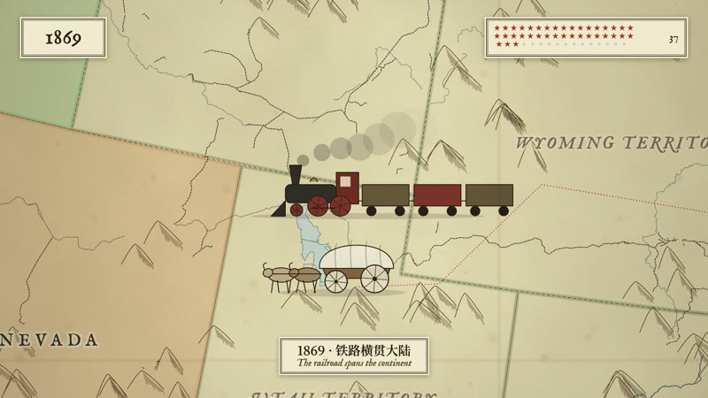
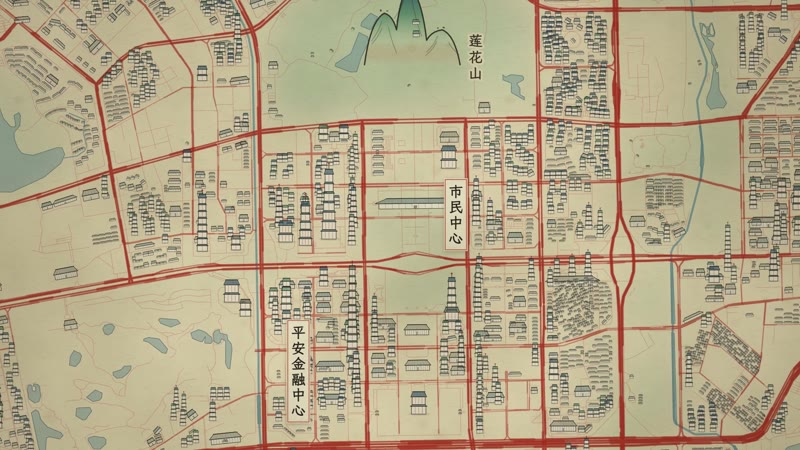
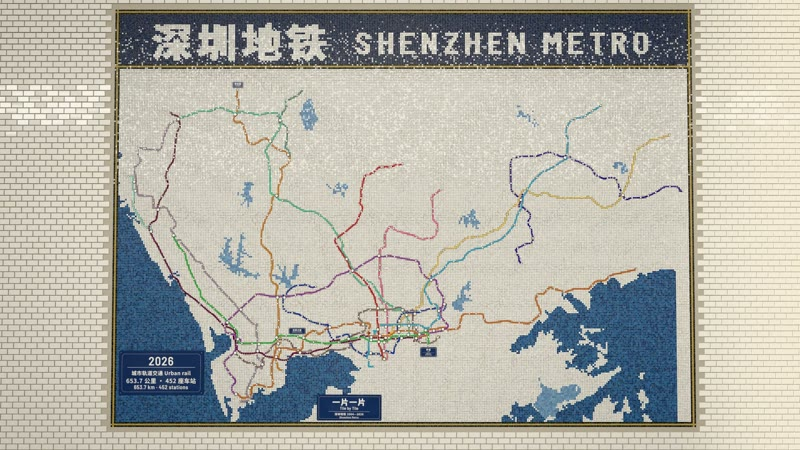
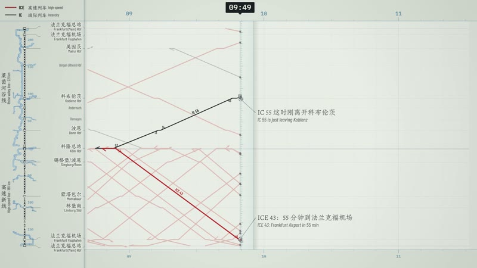
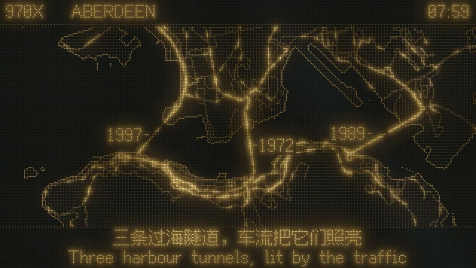
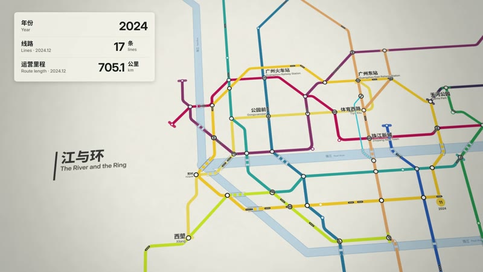

<div align="center">

# NEO-Cine

**Film styles made in code, by NEO, one at a time.**<br>
Pick a style, bring your story, and let your coding agent direct.<br>
<sub>NEO 的代码影片风格库，风格一个一个做，每种都配一支完全用代码做出来的短片 · 🇨🇳 中文用户请看 <a href="README.zh-CN.md">简体中文说明</a></sub>

<a href="https://neohoy.github.io/neo-cine/"></a> <a href="README.zh-CN.md"></a> <a href="https://github.com/neohoy/neo-cine/stargazers"></a> <a href="#thanks-and-licence"></a>

⚠️ **Built for Claude Code.** The styles are made and tuned with Claude;<br>
other agents may not reproduce them well.

🆕 **2026-11-13 · [Styles 04–07: Transport](https://neohoy.github.io/neo-cine/)**: a new series built on real networks and real timetables (OpenStreetMap lines, published GTFS times). **Metro Mosaic**: Shenzhen's metro laid tile by tile on a station wall, 2004 to 2026. **Train Graph**: one real day of long-distance trains between Köln and Frankfurt, drafted as a train graph. **Bus Dot Matrix**: one real Wednesday of Hong Kong's cross-harbour buses on an amber LED board. **Transit Map**: Guangzhou's metro dragged out line by line on a printed octilinear map, 1997 to 2025, adapted from Lemo-Opuscar's Transit Map. [See them ↓](#the-styles)

<sub>Official repo: [github.com/neohoy/neo-cine](https://github.com/neohoy/neo-cine) · by NEO造物集 ([@neohoy](https://github.com/neohoy))</sub>

</div>

## The styles

One frame and one line for each style. Click a frame for its `STYLE.md`, and watch the films in the [gallery](https://neohoy.github.io/neo-cine/). More are on the way, one at a time.

<!-- styles:start -->

<table>
<tr>
<td width="33%" valign="top"><a href="styles/folding-city/STYLE.md"></a><br><b>01 · Folding City</b><br><sub>Graphic &amp; Type · <i>Shenzhen, Folded</i> · 0:40</sub><br>Three districts of Shenzhen as flat posters that open into streets, fold like doors and screens, and stand up as walls until the city closes into a U.<br><sub><a href="styles/folding-city/STYLE.md">Style prompt</a> · <a href="styles/folding-city/DEMO.md">Demo notes</a> · <a href="https://github.com/neohoy/neo-cine/releases/download/films/folding-city.mp4">Download 1080p</a></sub></td>
<td width="33%" valign="top"><a href="styles/atlas-scroll/STYLE.md"></a><br><b>02 · Atlas Scroll</b><br><sub>Real Maps · <i>From Thirteen to Fifty</i> · 0:56</sub><br>A hand-coloured atlas plate unrolls westward: the states take their colours year by year, a covered wagon leads the way to the Pacific, and in 1869 the railway overtakes it.<br><sub><a href="styles/atlas-scroll/STYLE.md">Style prompt</a> · <a href="styles/atlas-scroll/DEMO.md">Demo notes</a> · <a href="https://github.com/neohoy/neo-cine/releases/download/films/atlas-scroll.mp4">Download 1080p</a></sub></td>
<td width="33%" valign="top"><a href="styles/scroll-map/STYLE.md"></a><br><b>03 · Scroll Map</b><br><sub>Real Maps · <i>Shenzhen, Unrolled</i> · 0:48</sub><br>A handscroll unrolls along the real coast of Shenzhen: ink traces the shore, blue-green mountains stand up, cinnabar roads spread from Luohu and the towers of Futian rise as tiered pavilions.<br><sub><a href="styles/scroll-map/STYLE.md">Style prompt</a> · <a href="styles/scroll-map/DEMO.md">Demo notes</a> · <a href="https://github.com/neohoy/neo-cine/releases/download/films/scroll-map.mp4">Download 1080p</a></sub></td>
</tr>
<tr>
<td width="33%" valign="top"><a href="styles/metro-mosaic/STYLE.md"></a><br><b>04 · Metro Mosaic</b><br><sub>Transport · <i>Tile by Tile</i> · 0:56</sub><br>On a white-tiled station wall, Shenzhen&#x27;s real metro is laid tile by tile in the order it opened, from one green tile at Luohu in 2004 to the last station tile in 2026, until a passing train lights the whole glazed wall.<br><sub><a href="styles/metro-mosaic/STYLE.md">Style prompt</a> · <a href="styles/metro-mosaic/DEMO.md">Demo notes</a> · <a href="https://github.com/neohoy/neo-cine/releases/download/films/metro-mosaic.mp4">Download 1080p</a></sub></td>
<td width="33%" valign="top"><a href="styles/train-graph/STYLE.md"></a><br><b>05 · Train Graph</b><br><sub>Transport · <i>Two Lines, One Day</i> · 0:56</sub><br>One real day of German long-distance trains between Köln and Frankfurt, drafted as a train graph: the real line straightens into the distance axis, and the high-speed line and the Rhine valley draw two different slopes.<br><sub><a href="styles/train-graph/STYLE.md">Style prompt</a> · <a href="styles/train-graph/DEMO.md">Demo notes</a> · <a href="https://github.com/neohoy/neo-cine/releases/download/films/train-graph.mp4">Download 1080p</a></sub></td>
<td width="33%" valign="top"><a href="styles/bus-dotmatrix/STYLE.md"></a><br><b>06 · Bus Dot Matrix</b><br><sub>Transport · <i>A Day Under the Harbour</i> · 0:52</sub><br>An amber LED board plays one real Wednesday of Hong Kong&#x27;s cross-harbour buses, first light to 5 a.m.: no tunnel is drawn under the harbour, the morning rush lights all three.<br><sub><a href="styles/bus-dotmatrix/STYLE.md">Style prompt</a> · <a href="styles/bus-dotmatrix/DEMO.md">Demo notes</a> · <a href="https://github.com/neohoy/neo-cine/releases/download/films/bus-dotmatrix.mp4">Download 1080p</a></sub></td>
</tr>
<tr>
<td width="33%" valign="top"><a href="styles/transit-map/STYLE.md"></a><br><b>07 · Transit Map</b><br><sub>Transport · <i>The River and the Ring</i> · 0:54</sub><br>A printed octilinear map of Guangzhou&#x27;s real metro is dragged out line by line from five stations under the Pearl River in 1997, trains running on every finished line, until Line 11 closes the ring and the counter lands on 19 lines and 779.9 km.<br><sub><a href="styles/transit-map/STYLE.md">Style prompt</a> · <a href="styles/transit-map/DEMO.md">Demo notes</a> · <a href="https://github.com/neohoy/neo-cine/releases/download/films/transit-map.mp4">Download 1080p</a></sub></td>
<td width="33%" valign="top"></td>
<td width="33%" valign="top"></td>
</tr>
</table>

<sub><b>Real Maps</b> (02, 03): A series built on OpenStreetMap (the ground as it is today) and OpenHistoricalMap (borders, railways and routes by year): the map is real, the look changes from style to style.</sub>

<sub><b>Transport</b> (04, 05, 06, 07): Real metro, rail and bus networks and their real timetables: the lines come from OpenStreetMap, the times from the GTFS feeds operators publish; the look changes from style to style.</sub>
<!-- styles:end -->

## 👋 About

I'm **NEO** ([@neohoy](https://github.com/neohoy)), and this is the film library of NEO造物集.

> **One style at a time.** Every style here starts from a blank page and ships with a finished film and its full source.

A style is not a template with parameters: it is a written description of a look, a way of moving and a sound, plus one demo film. The agent reads the style, writes its own treatment for your topic, and directs, draws, scores and mixes the film by writing code:

- 🎨 **Picture**: canvas and WebGL pages, rendered frame by frame
- 🎵 **Music and sound effects**: driven by the same timeline as the picture
- 🎙️ **Voice**: text-to-speech narration, when a film needs one

No video generation, no stock footage.

## How to use

Two ways in; the skill is the easiest.

### Option 1: install the skill (recommended)

In your terminal:

```sh
claude plugin marketplace add neohoy/neo-cine
claude plugin install neo-cine@neo
```

Then use it from any folder.

- On first use it downloads the guides, tools and style prompts to `~/neo-cine`, shared by all your films.
- Each film's project, from source to finished video, goes in the folder you started from.
- For other agents, copy [`plugin/skills/neo-cine/`](plugin/skills/neo-cine/) into their skills folder.

### Option 2: clone the repo

```sh
git clone https://github.com/neohoy/neo-cine.git
cd neo-cine
sh plugin/skills/neo-cine/scripts/setup.sh deps
```

Then start your agent in that folder and ask it to read [`AGENTS.md`](AGENTS.md). Films go into `films/<name>/` inside the repo.

### Then just say what you want

> Make a 40-second film in the **Folding City** style about Hong Kong: Central, Kowloon and the harbour.

> Make a 30-second vertical film in the **Folding City** style that walks through our campus, building by building.

Name the style in English or Chinese.

Not sure yet? With the skill installed, type `/neo-cine:neo-cine` and nothing else. It asks which language to use, then what you'd like to do.

It asks you once, up front:

- anything it can't decide about your topic;
- whether you have your own **voice, music or other material**;
- whether you want to see a **storyboard** first. Say yes and it stops once to show you the key shots in the real style; otherwise it goes straight to the finished film.

The agent reads three guides and works like a small studio:

| File | What it gives the agent |
|---|---|
| [`DIRECTOR.md`](DIRECTOR.md) | how to direct: story, sound, rhythm, camera, performance, self-checks |
| [`TECHNIQUE.md`](TECHNIQUE.md) | how to build: frame-by-frame rendering, voice, music, mixing |
| `styles/<style>/STYLE.md` | what the style looks and sounds like; the story is yours |

Every delivery carries a version number (`-v001`, `-v002`, …): the film, the poster and the treatment. Nothing is overwritten.

### Make a style your own

Change a library style into one that's only yours (your colours, logo, fonts, characters), or make one from a blank page:

> I want to change the **Folding City** style into my own version.

> Start from a blank page: a chalk-on-blackboard style, warm and slow.

It plans the changes with you one question at a time, shows one style frame, then a 15–30 second demo film, and keeps the style only when you say so. Your styles live in `~/neo-my-styles/<name>/`; library updates never touch them. The steps the agent follows are in [`MY-STYLES.md`](MY-STYLES.md).

### Before you start

- A film is real work for an agent: it runs for a good while and uses a fair amount of tokens.
- You need Node 20+, ffmpeg 7+ and Python 3.11+ (or [uv](https://docs.astral.sh/uv/)); the agent installs the rest. Ubuntu 24.04 ships ffmpeg 6.1, which is too old: use a [static build](https://johnvansickle.com/ffmpeg/).
- macOS and Windows (Git Bash); Linux needs working GPU drivers for the 3D styles.
- Default output 1920×1080, 24 fps; other sizes on request.

### Update or uninstall

Update, then restart Claude Code (the library in `~/neo-cine` updates itself on the next film):

```sh
claude plugin marketplace update neo && claude plugin update neo-cine@neo
```

Uninstall, then delete `~/neo-cine`:

```sh
claude plugin uninstall neo-cine@neo
```

Your own styles in `~/neo-my-styles/` stay through updates and uninstalls; delete that folder yourself if you don't want them.

If a step stays stuck, [open an issue](https://github.com/neohoy/neo-cine/issues).

## Star history

<a href="https://www.star-history.com/#neohoy/neo-cine&Date">
 <picture>
   <source media="(prefers-color-scheme: dark)" srcset="https://api.star-history.com/svg?repos=neohoy/neo-cine&type=Date&theme=dark" />
   <source media="(prefers-color-scheme: light)" srcset="https://api.star-history.com/svg?repos=neohoy/neo-cine&type=Date" />
   
 </picture>
</a>

## Thanks and licence

- **Thanks to Lemomo ([@lemomo_ai](https://x.com/lemomo_ai)), a very talented designer.** NEO-Cine's framework follows Lemomo's skill [Lemo-Opuscar](https://github.com/lemomo-ai/lemo-opuscar); the styles here are our own.
- **Thanks to Yuma Garments ([@garments__](https://x.com/garments__)).** Those illusion animations gave Folding City its idea. Technique only; none of those pictures are used.
- **Licence**: [MIT](LICENSE). Films you make with the library are yours.

---

<div align="center">

⭐ **Star this repo**<br>
👀 **Watch → Custom → Releases** to hear about new styles

<sub>NEO造物集 · by neohoy</sub>

</div>
