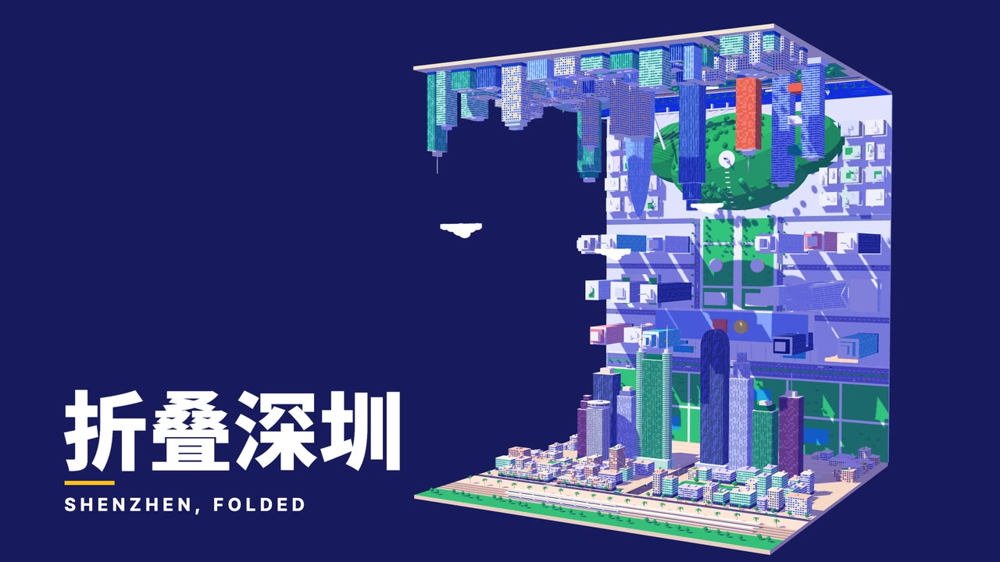
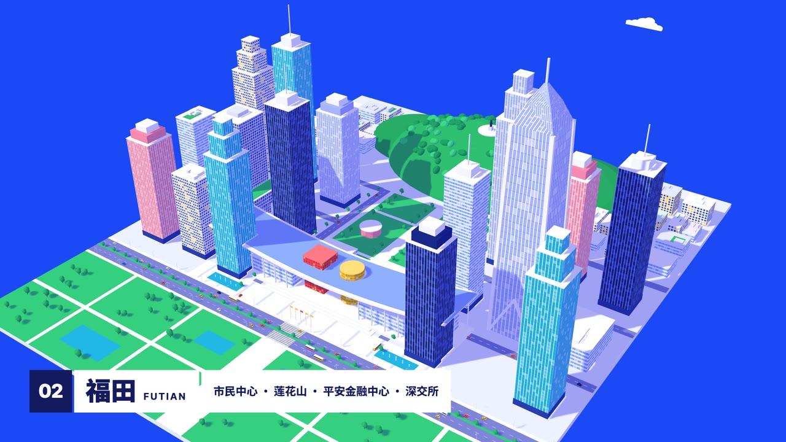
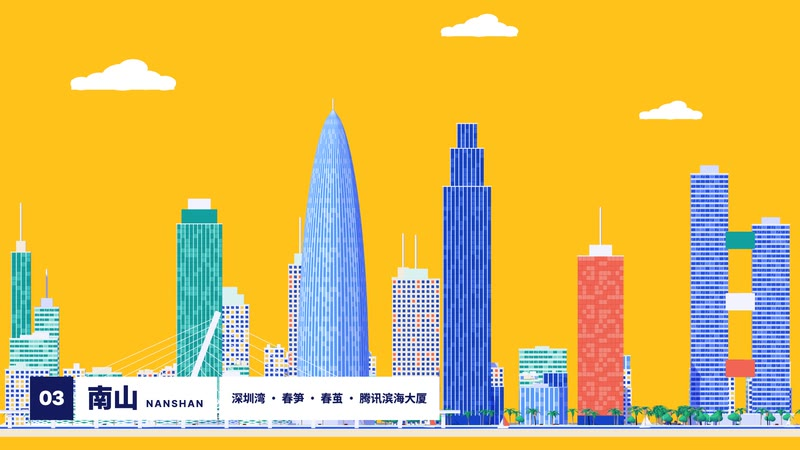
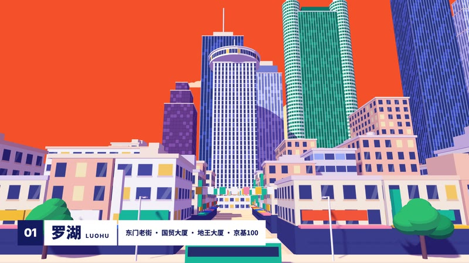
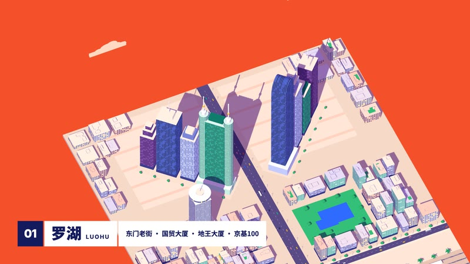
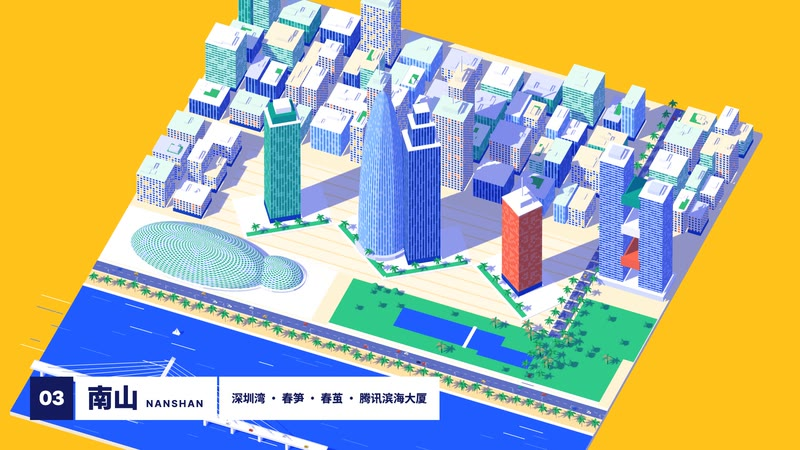
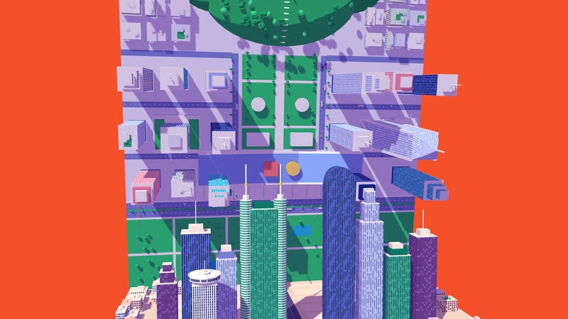
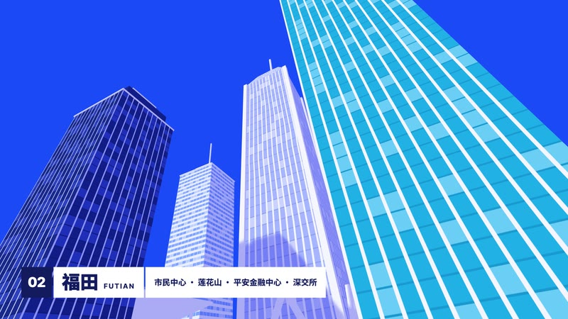

<div align="center">

# NEO-Cine

**Film styles made in code, by NEO, one at a time.**<br>
Pick a style, bring your story, and let your coding agent direct.<br>
<sub>NEO 的代码影片风格库，风格一个一个做，每种都配一支完全用代码做出来的短片 · 🇨🇳 中文用户请看 <a href="README.zh-CN.md">简体中文说明</a></sub>

<a href="styles/folding-city/STYLE.md"></a> <a href="README.zh-CN.md"></a> <a href="https://github.com/neohoy/neo-cine/stargazers"></a> <a href="#thanks-and-licence"></a>

⚠️ **Built for Claude Code.** The styles are made and tuned with Claude;<br>
other agents may not reproduce them well.

🆕 **2026-11-10 · [Style 01: Folding City](styles/folding-city/STYLE.md)**: a flat poster city that opens, folds and stands up. [See it ↓](#the-styles)

<sub>Official repo: [github.com/neohoy/neo-cine](https://github.com/neohoy/neo-cine) · by NEO造物集 ([@neohoy](https://github.com/neohoy))</sub>

</div>

## 🎬 Style 01: Folding City

<table><tr>
<td width="50%" valign="top"><a href="https://github.com/neohoy/neo-cine/releases/download/films/folding-city.mp4"></a><br><b>▶ The demo film</b> · <i>Shenzhen, Folded</i> · 40 s<br><sub>Luohu, Futian, Nanshan: three districts on one hinge chain, in one take. No narration; the score and every sound effect are synthesized in code.</sub></td>
<td width="50%" valign="top"><a href="styles/folding-city/STYLE.md"></a><br><b>The style, open</b> · style prompt · shot table · full source<br><sub>A city drawn as a flat poster that is really a 3D model. Take the look, the moves and the sound to your own city, campus or product.</sub></td>
</tr></table>

What the style does:

<table>
<tr>
<td width="33%" valign="top"><br><b>A poster</b><br><sub>Flat colour, no outlines, no perspective: every district starts as a print.</sub></td>
<td width="33%" valign="top"><br><b>The poster opens</b><br><sub>The camera pulls in and the same picture gains depth: you are standing in the street.</sub></td>
<td width="33%" valign="top"><br><b>Door fold</b><br><sub>Two rows of towers swing in on hinges like a pair of doors.</sub></td>
</tr>
<tr>
<td width="33%" valign="top"><br><b>Screen fold</b><br><sub>A waterfront row folds into a zigzag screen, then flattens again.</sub></td>
<td width="33%" valign="top"><br><b>A plate stands up</b><br><sub>The next district slides in and rises as a wall; the camera tips over and it becomes the ground.</sub></td>
<td width="33%" valign="top"><br><b>The canyon</b><br><sub>Straight up between the towers, the one view a poster can't give you.</sub></td>
</tr>
</table>

<div align="center">

Every frame and every note of it was written in code.<br>
[**▶ Download the film (1080p, 53 MB)**](https://github.com/neohoy/neo-cine/releases/download/films/folding-city.mp4) · [**Style prompt**](styles/folding-city/STYLE.md) · [**Demo notes and shot table**](styles/folding-city/DEMO.md) · [**Source**](styles/folding-city/demo/)

</div>

## 👋 About

I'm **NEO** ([@neohoy](https://github.com/neohoy)), and this is the film library of NEO造物集.

> **One style at a time.** Every style here starts from a blank page and ships with a finished film and its full source.

A style is not a template with parameters: it is a written description of a look, a way of moving and a sound, plus one demo film. The agent reads the style, writes its own treatment for your topic, and directs, draws, scores and mixes the film by writing code:

- 🎨 **Picture**: canvas and WebGL pages, rendered frame by frame
- 🎵 **Music and sound effects**: driven by the same timeline as the picture
- 🎙️ **Voice**: text-to-speech narration, when a film needs one

No video generation, no stock footage.

## How to use

Two ways in; the skill is the easiest.

### Option 1: install the skill (recommended)

In your terminal:

```sh
claude plugin marketplace add neohoy/neo-cine
claude plugin install neo-cine@neo
```

Then use it from any folder.

- On first use it downloads the guides, tools and style prompts to `~/neo-cine`, shared by all your films.
- Each film's project, from source to finished video, goes in the folder you started from.
- For other agents, copy [`plugin/skills/neo-cine/`](plugin/skills/neo-cine/) into their skills folder.

### Option 2: clone the repo

```sh
git clone https://github.com/neohoy/neo-cine.git
cd neo-cine
sh plugin/skills/neo-cine/scripts/setup.sh deps
```

Then start your agent in that folder and ask it to read [`AGENTS.md`](AGENTS.md). Films go into `films/<name>/` inside the repo.

### Then just say what you want

> Make a 40-second film in the **Folding City** style about Hong Kong: Central, Kowloon and the harbour.

> Make a 30-second vertical film in the **Folding City** style that walks through our campus, building by building.

Name the style in English or Chinese.

Not sure yet? With the skill installed, type `/neo-cine:neo-cine` and nothing else. It asks which language to use, then what you'd like to do.

It asks you once, up front:

- anything it can't decide about your topic;
- whether you have your own **voice, music or other material**;
- whether you want to see a **storyboard** first. Say yes and it stops once to show you the key shots in the real style; otherwise it goes straight to the finished film.

The agent reads three guides and works like a small studio:

| File | What it gives the agent |
|---|---|
| [`DIRECTOR.md`](DIRECTOR.md) | how to direct: story, sound, rhythm, camera, performance, self-checks |
| [`TECHNIQUE.md`](TECHNIQUE.md) | how to build: frame-by-frame rendering, voice, music, mixing |
| `styles/<style>/STYLE.md` | what the style looks and sounds like; the story is yours |

Every delivery carries a version number (`-v001`, `-v002`, …): the film, the poster and the treatment. Nothing is overwritten.

### Make a style your own

Change a library style into one that's only yours (your colours, logo, fonts, characters), or make one from a blank page:

> I want to change the **Folding City** style into my own version.

> Start from a blank page: a chalk-on-blackboard style, warm and slow.

It plans the changes with you one question at a time, shows one style frame, then a 15–30 second demo film, and keeps the style only when you say so. Your styles live in `~/neo-my-styles/<name>/`; library updates never touch them. The steps the agent follows are in [`MY-STYLES.md`](MY-STYLES.md).

### Before you start

- A film is real work for an agent: it runs for a good while and uses a fair amount of tokens.
- You need Node 20+, ffmpeg 7+ and Python 3.11+ (or [uv](https://docs.astral.sh/uv/)); the agent installs the rest. Ubuntu 24.04 ships ffmpeg 6.1, which is too old: use a [static build](https://johnvansickle.com/ffmpeg/).
- macOS and Windows (Git Bash); Linux needs working GPU drivers for the 3D styles.
- Default output 1920×1080, 24 fps; other sizes on request.

### Update or uninstall

Update, then restart Claude Code (the library in `~/neo-cine` updates itself on the next film):

```sh
claude plugin marketplace update neo && claude plugin update neo-cine@neo
```

Uninstall, then delete `~/neo-cine`:

```sh
claude plugin uninstall neo-cine@neo
```

Your own styles in `~/neo-my-styles/` stay through updates and uninstalls; delete that folder yourself if you don't want them.

If a step stays stuck, [open an issue](https://github.com/neohoy/neo-cine/issues).

## The styles

Click a frame for its `STYLE.md`. More are on the way, one at a time.

<!-- styles:start -->

### Graphic & Type

<table>
<tr>
<td width="33%" valign="top"><a href="styles/folding-city/STYLE.md"></a><br><b>Folding City</b><br><i>Shenzhen, Folded</i><br><sub>Three districts of Shenzhen as flat posters that open into streets, fold like doors and screens, and stand up as walls until the city closes into a U.</sub></td>
<td width="33%" valign="top"></td>
<td width="33%" valign="top"></td>
</tr>
</table>
<!-- styles:end -->

## Thanks and licence

- **Thanks to [Lemo-Opuscar](https://github.com/lemomo-ai/lemo-opuscar) by LemoLab.** NEO-Cine is built on its framework and production tools (MIT); the styles here are NEO's own. What is kept as it is and how updates are followed: [UPSTREAM.md](UPSTREAM.md).
- **Thanks to Yuma Garments ([@garments__](https://x.com/garments__)).** Those illusion animations gave Folding City its idea. Technique only; none of those pictures are used.
- **Licence**: [MIT](LICENSE). Films you make with the library are yours.

---

<div align="center">

⭐ **Star this repo**<br>
👀 **Watch → Custom → Releases** to hear about new styles

<sub>NEO造物集 · by neohoy</sub>

</div>
